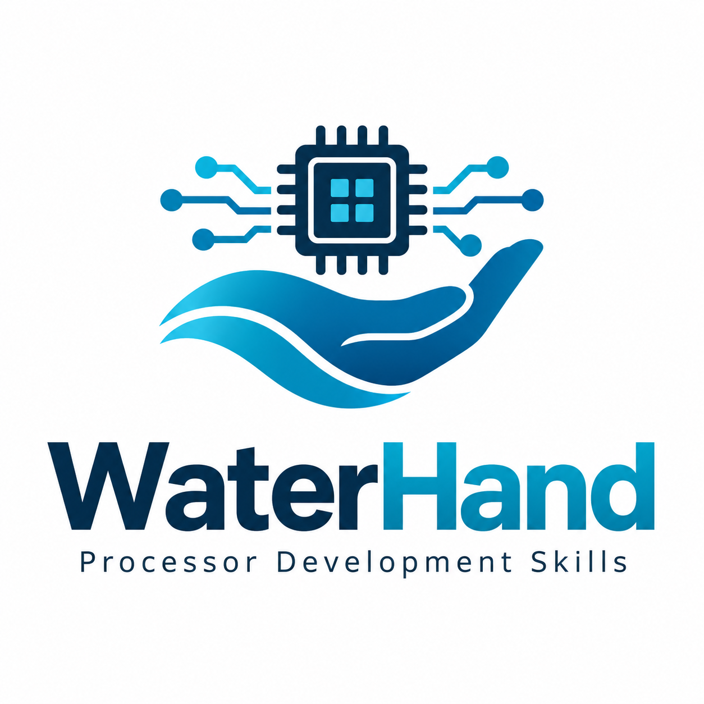

# WaterHand Processor Development Skills

[中文](README.md) | English

  

Reusable Skills that capture processor engineering experience and help individuals and small teams get more design work done.

A microarchitecture change often affects design documents, module interfaces, pipeline control, source code, and tests. WaterHand packages the reading methods, analysis steps, recurring failure patterns, and checks from this work into six Skills that Codex can use in a processor project. Designers set the goals, decide architectural tradeoffs, and accept results. The Agent performs authorized analysis, edits, and verification.

These methods come from processor development practice and apply to course projects, research prototypes, and existing Chisel projects. Design facts, source code, and verification records remain in the user's project.

## Six Skills

| Skill | Purpose |
|---|---|
| [bootstrap-processor-project](skills/bootstrap-processor-project/SKILL.md) | Establish a project-root `AGENTS.md` with fact ownership, authorization, and tool entrypoints |
| [organize-processor-docs](skills/organize-processor-docs/SKILL.md) | Organize design documents and reading paths between modules, protocols, and verification evidence |
| [design-chisel-processor](skills/design-chisel-processor/SKILL.md) | Review and refine microarchitecture, including interfaces, cycle behavior, and state lifecycles |
| [implement-chisel-processor](skills/implement-chisel-processor/SKILL.md) | Implement confirmed designs in Chisel RTL and maintain source summaries, assertions, and tests |
| [trace-vivado-timing-to-rtl](skills/trace-vivado-timing-to-rtl/SKILL.md) | Trace Vivado timing evidence to RTL, Chisel source, and pipeline stages |
| [optimize-chisel-fpga-timing](skills/optimize-chisel-fpga-timing/SKILL.md) | Develop timing optimization candidates and compare functional and physical results |

## Getting started

The [user guide](USER_GUIDE.en.md) covers installation, inputs, and example requests for each Skill, with screenshots from actual projects. An existing design review is one place to start; combine Skills as the work requires.

Codex provides model access, sessions, file editing, and tool execution. The user's project owns its compilation, simulation, and synthesis environments and commands. The document checker and timing report extractor ship with their respective Skills. Download packages from [GitHub Releases](https://github.com/sixblade325/WaterHand-Processor-Development-Skills/releases).

The guide is available in Chinese and English. All six Skill directories are shared between the two editions. The guide explains the existing language defaults and how to request English output.

## Historical reports

`report/` contains three Chinese-language PDFs submitted to a competition in September 2026. They describe the project at that time and the experiments conducted then:

- [Project overview](report/作品简介.pdf)
- [Design report](report/设计文档.pdf)
- [Experiment supplement](report/实验补充说明.pdf)

The reports retain their submitted content. The Windows Execution Support Kit described in them was removed on October 3, 2026. This README, the user guide, and each `SKILL.md` describe the current package. Interpret experimental conclusions within the model, environment, input baseline, and verification scope stated in each report.

See [CONTRIBUTING](CONTRIBUTING.en.md) for maintenance and contribution instructions and [CHANGELOG](CHANGELOG.en.md) for release history.

## License

The Skills, scripts, templates, and documentation use the [Mulan Permissive Software License, Version 2](LICENSE), identified as `MulanPSL-2.0`. Separately attributed third-party materials, external tools, and user processor projects retain their own licenses.
