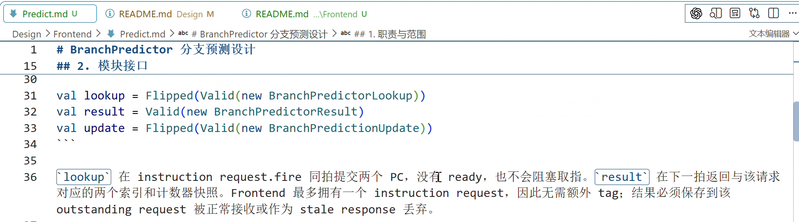
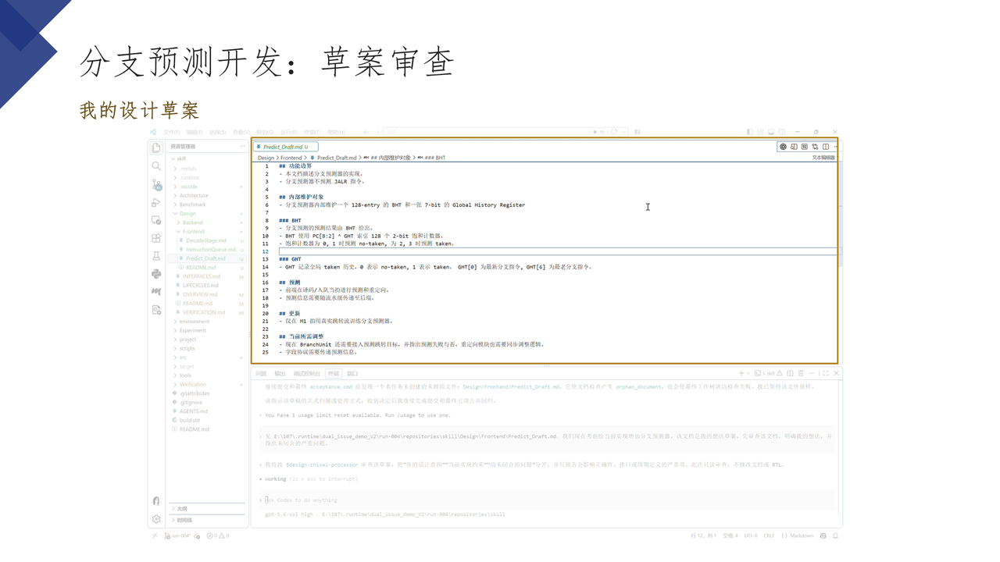
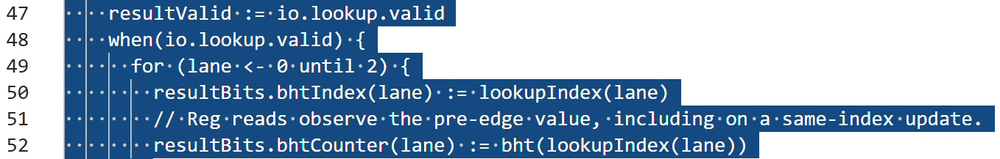
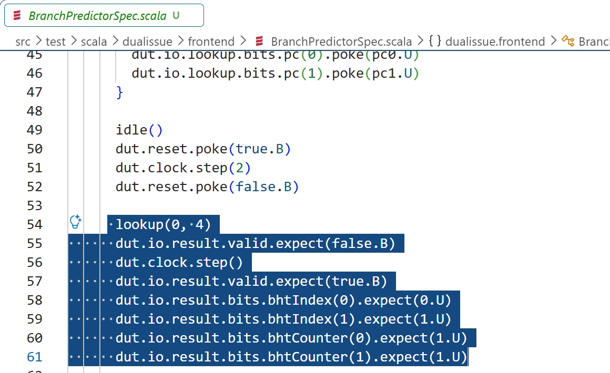
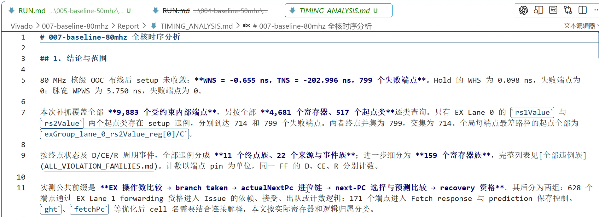
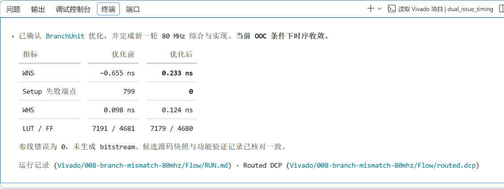

# WaterHand User Guide

[中文](USER_GUIDE.md) | English

This guide explains when to use each of the six Skills, what to prepare, and how to check the results. Examples use a Chisel processor project. Replace document paths with those used by your project.

- [Installation and preparation](#installation-and-preparation)
- [Establish project collaboration rules](#establish-project-collaboration-rules)
- [Organize engineering documents](#organize-engineering-documents)
- [Design and review microarchitecture](#design-and-review-microarchitecture)
- [Implement and verify Chisel RTL](#implement-and-verify-chisel-rtl)
- [Trace Vivado timing paths](#trace-vivado-timing-paths)
- [Optimize FPGA timing](#optimize-fpga-timing)
- [Combine Skills](#combine-skills)

Screenshots and the animation come from actual engineering work in September 2026. They preserve the original Chinese text and show historical conversations, documents, and results. Windows paths and commands in the images belong to those examples; use your own project's declared tool entrypoints. The [media notes](assets/user-guide/README.en.md) record the sources and limits of each illustration.

## Installation and preparation

Download and extract a Skill package from [Releases](https://github.com/sixblade325/WaterHand-Processor-Development-Skills/releases), or clone the `opensource` branch:

```sh
git clone --branch opensource https://github.com/sixblade325/WaterHand-Processor-Development-Skills.git
```

Create `.agents/skills/` in the target processor project. Copy each Skill you need from this package's `skills/` directory, including its entire directory and any `references/`, `assets/`, `scripts/`, and `agents/` contents. For example:

```text
your-processor/
├── .agents/
│   └── skills/
│       ├── design-chisel-processor/
│       │   ├── SKILL.md
│       │   └── references/
│       └── implement-chisel-processor/
│           ├── SKILL.md
│           ├── agents/
│           └── references/
├── AGENTS.md
├── doc/
└── src/
```

This tree omits some files. Copy complete Skill directories. The target project maintains its root `AGENTS.md`. If a Skill with the same name is already installed, compare versions and local edits before deciding what to replace. For use across projects, install Skills under `~/.agents/skills/` and keep one clearly maintained copy.

Open Codex in the target project and check that the installed Skills appear in the available list. In the CLI or IDE extension, use `/skills` to inspect them and `$<skill-name>` in a request to select one. Other interfaces provide their own Skill selection controls. Restart Codex if discovery has not refreshed. Installation locations and invocation follow the [official Skill documentation](https://developers.openai.com/codex/skills/).

Before starting engineering work, prepare the project's `AGENTS.md`, relevant Architecture and Design documents, source code, and existing verification evidence. Confirm the actual compilation, simulation, or Vivado entrypoints. The document checker and timing extractor require Python 3.10 or later. Hardware tool versions belong to the target project.

A request should specify the task, input locations, permitted edits, and completion criteria. Adapt this example:

```text
Use $design-chisel-processor to review the branch predictor draft.
Read the project AGENTS.md, the draft under doc/Design/Frontend, and the existing frontend design.
Check prediction propagation, training, recovery, and stall behavior. Give concrete cycle counterexamples and unresolved decisions.
Keep this task read-only.
```

When later decisions have been recorded in formal documents, point the Agent to those files. Source code, tests, and tool output provide implementation and verification evidence for the designer to assess.

### Language

The Chinese and English guides use the same six Skill directories. Their methods, templates, scripts, and UI metadata are unchanged in this bilingual documentation release. The bootstrap template still defaults human-readable content to Chinese. For English output, state the requested language explicitly and follow the target project's existing language rules. For example, add `Write this review in English.` to your request. A lasting change to an existing project's `AGENTS.md` requires the project owner's authorization.

### Install through the repository marketplace

The repository also includes `.agents/plugins/marketplace.json`. Its root plugin contains all six Skills. With a Codex CLI that supports repository marketplaces, add a pinned source:

```sh
codex plugin marketplace add sixblade325/WaterHand-Processor-Development-Skills --ref v3.1.1
```

If your CLI supports `codex plugin add`, continue with:

```sh
codex plugin add processor-development-skills@waterhand-processor-development-skills
```

In a desktop client that supports this source, you can also open the plugin marketplace, select WaterHand Processor Development Skills, and install it. Reopen the project session and check the available Skills. If the project already has Skills with the same names, choose which copy to maintain to avoid duplicate loading. Both marketplace installation and manual copying depend on host support. See the [official plugin documentation](https://developers.openai.com/plugins/build/plugins) for interface and refresh behavior.

### Update and remove

For manual installation, compare the new version against local edits in the installed directories before replacing complete Skill directories. To remove a Skill, delete only the directory you installed. The project continues to own its `AGENTS.md`, designs, source code, and verification material.

For plugin installation, use the host's plugin management controls to update or uninstall it. Update the pinned Git ref when selecting a new version. `SHA256SUMS` verifies downloaded files; `release-manifest.json` records the version, source commit, and file information.

## Establish project collaboration rules

[`bootstrap-processor-project`](skills/bootstrap-processor-project/SKILL.md) initializes the project-root `AGENTS.md`. It brings together formal document locations, authorization boundaries, existing tool entrypoints, and the task Skill index so later sessions can find the project's rules.

For a new project:

```text
Use $bootstrap-processor-project to initialize AGENTS.md for this processor project.
Read the existing directory layout and project description. Record verified document paths and tool entrypoints.
Use the package defaults where no existing mapping is available. Modify only the root AGENTS.md.
```

Default mappings are `doc/Architecture/`, `doc/Design/`, `doc/Verification/`, `src/`, and `.runtime/`. This task creates only the rules file. Later work creates document directories as needed. Existing projects retain their explicit path mappings.

If the project already has an `AGENTS.md`, request a comparison:

```text
Use $bootstrap-processor-project to compare the current AGENTS.md with the package baseline.
List missing rules, conflicts, and proposed incremental changes. Wait for my confirmation before editing.
```

Check that paths and commands come from existing project evidence, authorization rules are complete, and existing constraints are preserved. After initialization, the project owns the file. A Skill upgrade requires a separate assessment of any proposed rule changes.

## Organize engineering documents

[`organize-processor-docs`](skills/organize-processor-docs/SKILL.md) helps when document entrypoints are hard to find, facts are repeated across files, or a design change requires related explanations to be updated. It organizes processor goals, detailed designs, verification evidence, and research by responsibility so people and Agents follow the same reading paths.

It offers three workflows: `Bootstrap` establishes necessary structure, `Author` writes documents, and `Maintain` checks and organizes existing material. Specify the scope and reading problem:

```text
Use the Maintain workflow of $organize-processor-docs to organize the frontend design documents.
Follow the directory mappings in the project AGENTS.md. Preserve existing module boundaries and design conclusions.
Check duplicate definitions, missing links, and overly long documents. Organize entrypoints by module and link cross-module protocols and verification evidence.
Propose any changes to fact ownership or directory locations before applying them.
```

The result should tell readers where a module is described, who owns its interfaces, and how to find the related source and tests. Maintain each rule in one authoritative location, with summaries and links elsewhere. Present Chisel interface declarations before explaining their fields.



The screenshot shows a document produced in the historical example. There is no corresponding recording of the document organization invocation; the image illustrates the resulting document format.

Run the bundled checker from the target project root after installing the Skill as described above:

```sh
python .agents/skills/organize-processor-docs/scripts/check_docs.py . --json
```

The checker discovers document domains under `doc/` by default. For other layouts, repeat `--root`, for example `--root Architecture --root Microarchitecture`. It checks links, reading depth, encoding, conflict markers, and length budgets. Design semantics require review of the documents and source code.

## Design and review microarchitecture

[`design-chisel-processor`](skills/design-chisel-processor/SKILL.md) supports proposing mechanisms, reviewing drafts, and completing interfaces and cycle behavior before implementation. Typical subjects include pipelines, queues, issue logic, branch prediction, caches, MSHRs, forwarding, wakeup, and exception recovery.

Provide the current design, relevant source code, goals, and constraints. The Agent traces where fields are produced, stored, and consumed; checks set and clear conditions, same-cycle priorities, flushes, retries, late responses, and entry reuse; and explains defects with trigger conditions and concrete cycle counterexamples.

```text
Use $design-chisel-processor to review doc/Design/Frontend/Predict_Draft.md.
Check lookup, training, backpressure, and exception recovery against the current Fetch, Decode, and redirect designs.
Preserve existing pipeline and interface constraints. List unresolved conditions, candidate solutions, and their costs.
Return the review only. Wait for my confirmation before updating design documents.
```



This 12-second animation consists of three screenshots: the draft, the review request, and the Agent stating which design Skill it will use. Subsequent discussion brings unresolved choices to the designer and records confirmed decisions in the formal design.


When checking the result, distinguish existing RTL, reference implementations, design drafts, and new proposals. A formal design needs explicit state and cycle contracts, with assertions or directed test requirements that follow from them. Proceed to implementation once the cycle semantics are settled.

## Implement and verify Chisel RTL

[`implement-chisel-processor`](skills/implement-chisel-processor/SKILL.md) starts from confirmed Architecture and Design documents and covers RTL, interface migration, source summaries, and tests. Supply the actual elaboration top, permitted files, and project test entrypoints.

```text
Use $implement-chisel-processor to implement the confirmed branch predictor design.
Follow doc/Design/Frontend/Predict.md and related pipeline-stage designs. Modify the specified Chisel source and tests.
Trace Bundle definitions, storage, producers, and consumers. Maintain source-adjacent _codex.md files.
Use verified project commands for compilation and focused simulation. Report test results and remaining verification gaps.
```

The Agent first checks whether the design determines the implementation, then traces all uses of affected interfaces. Each project-owned Scala source file added or changed by the task should have a `<SourceBase>_codex.md` in the same directory, describing responsibilities, interfaces, cycle behavior, and verification evidence.



Tests should exercise specific contracts. If a lookup and update to the same entry in the same cycle must return the old value, drive both operations together and check the next-cycle response and subsequent lookups.



Check interface consistency, updated source summaries, assertions and directed tests for the change, and the commands, exit status, and logs from actual execution. Successful compilation establishes that the build step passed. Simulation and other verification results establish functional behavior.

Dual-subagent verification is disabled by default. To request independent static review and independent testing, explicitly include `Enable dual-subagent verification` and state the permitted test scope.

## Trace Vivado timing paths

[`trace-vivado-timing-to-rtl`](skills/trace-vivado-timing-to-rtl/SKILL.md) explains timing bottlenecks. Prepare raw reports or a routed DCP, matching source and generated RTL, and the top, device, clock constraints, and run identity.

Choose the scope for the question:

| Mode | Question |
|---|---|
| `Targeted Path Trace` | Why does a named path, endpoint, or signal family limit timing? |
| `Whole-design Timing Audit` | Which paths limit the core, and how many endpoints do the main issues affect? |
| `Cross-run Comparison` | How did paths and physical results change between comparable runs? |

```text
Use the Whole-design Timing Audit mode of $trace-vivado-timing-to-rtl to analyze this run.
Inputs are the specified routed DCP, timing reports, source baseline, and generated RTL.
Verify clocks, constraints, and run identity. Separate logic and routing delay, and trace the main path families to Chisel.
Report evidence-backed modification directions. Keep Design and RTL read-only.
```



The report should let readers trace endpoints, primitives, and routing segments to RTL and their cycle meaning. Distinguish measurements, source mappings, inferences, and unknowns. Whole-core conclusions require endpoint coverage evidence. Limit local path conclusions to the scope actually examined.

The Skill includes a text-report extractor. Inspect its filtering and output options with:

```sh
python .agents/skills/trace-vivado-timing-to-rtl/scripts/extract_timing_path.py --help
```

The script helps organize reports. Verify path semantics against the original reports, DCP, and source code.

## Optimize FPGA timing

[`optimize-chisel-fpga-timing`](skills/optimize-chisel-fpga-timing/SKILL.md) applies when a bottleneck has been located and the task is to change the implementation and compare results. Specify the current cycle contract, baseline evidence, permitted scope, and retest conditions.

```text
Use $optimize-chisel-fpga-timing to optimize the identified critical path.
Start from this run's analysis and source. Check register boundaries, fire, backpressure, flush, and reset semantics for affected signals.
Compare candidate path benefits, resource costs, and verification requirements.
Implement the confirmed candidate, inspect generated RTL, run focused functional tests, and perform a routed A/B comparison with the same configuration.
```

The Skill examines comparators, selection networks, wide muxes, high-fanout controls, and register boundaries. Added pipeline latency, interface changes, or changes to visible behavior require an explicit designer decision. Before comparing physical results, verify the device, top, constraints, strategy, parameters, and source identity for both runs.



This screenshot records one retest under 80 MHz core out-of-context (OOC) conditions. Its conclusions apply to that run. Also check functional regression results, resource costs, and any new pressure on D inputs, Q outputs, feedback, control, and hold paths. Positive WNS under a constraint means the corresponding timing check passed under that constraint. Maximum frequency requires separate verification.

## Combine Skills

For a new project, start with `bootstrap-processor-project` to establish collaboration rules, then use `organize-processor-docs` to organize documents around actual content. In an existing project, enter through the Skill that addresses the current gap.

For design-to-implementation work, use `design-chisel-processor` to review mechanisms and unresolved conditions, update the formal design after the designer confirms it, then use `implement-chisel-processor` for RTL and tests. Keep documentation current throughout design and implementation changes.

For timing work, use `trace-vivado-timing-to-rtl` to identify evidence-backed bottlenecks and modification directions, then `optimize-chisel-fpga-timing` to implement confirmed candidates and retest them. Carry the input baseline, confirmed constraints, and unverified items into each handoff so later work can continue from project files.

Use and redistribution follow the root [MulanPSL-2.0 license](LICENSE). External tools and user projects retain their own licensing requirements.
